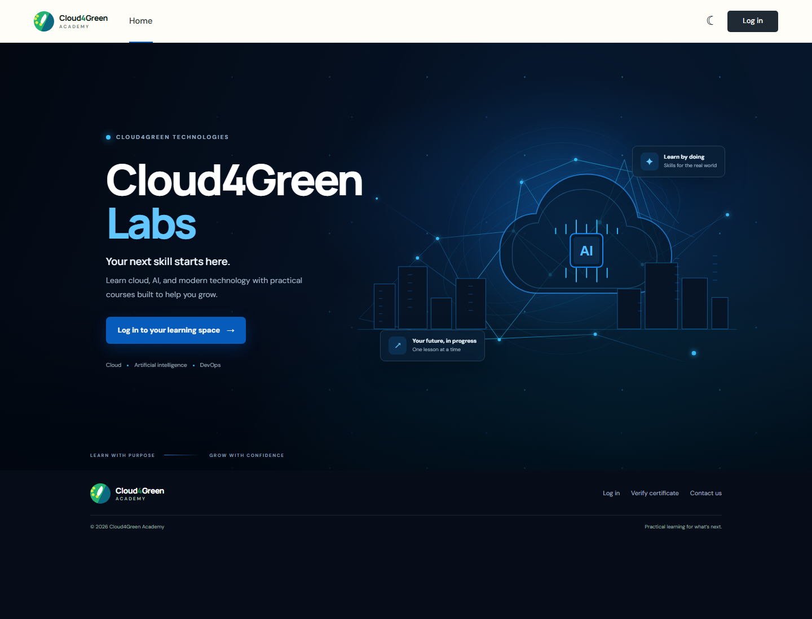
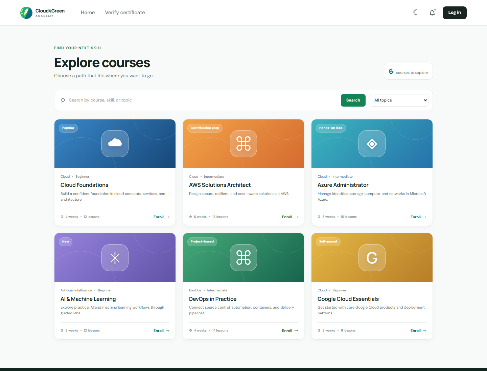

# Cloud4Green Academy

A Flask learning portal prototype with six course pathways, course-specific lesson tracking, an interactive course-guide assistant, badges, a demo leaderboard, and course completion certificates.

## Screenshots

### Landing page



### Course catalog



## Features

- Landing page, learner sign-in, dashboard, and searchable catalog.
- Six course outlines with independent enrollment and progress.
- Course-specific doubt-solver suggestions and topic-based responses. This is a prototype guide, not a live AI model.
- Badges, points, and a sample leaderboard.
- Automatic course certificates with public code verification.

## Run locally

### Windows Command Prompt

Install Python 3.12, then open Command Prompt in the project folder:

```bat
py -3.12 -m venv .venv
.venv\Scripts\activate
python -m pip install --upgrade pip
pip install -r requirements.txt
python app.py
```

Open [http://127.0.0.1:5053](http://127.0.0.1:5053).

### macOS or Linux

```bash
python3 -m venv .venv
source .venv/bin/activate
python -m pip install --upgrade pip
pip install -r requirements.txt
python app.py
```

## Try the demo

1. Sign in with any display name; this prototype does not use passwords.
2. Open **Courses**, choose a course, and enroll.
3. Use the course assistant's suggested questions or ask about a course topic.
4. Mark lessons complete to earn points. Completing every lesson issues a certificate.
5. Verify a certificate from the **Verify certificate** page.

Sample certificate codes: `C4G-CLOUD-2026-001` and `C4G-AWS-2026-014`.

## Deploy on Render

The included [`render.yaml`](render.yaml) is a Render Blueprint for a free web service:

1. Push this project to a GitHub repository.
2. In Render, choose **New → Blueprint**, connect the repository, and apply the blueprint.
3. Open the Render URL after the service finishes deploying.

Render generates a `SECRET_KEY` for the deployment. The free service uses an ephemeral filesystem, so SQLite certificate records can be lost when the service restarts or redeploys. Use persistent storage or a managed database if certificate records must survive restarts.

## Configuration and limitations

- Local certificate records are stored in `instance/certificates.sqlite3`. The `instance/` folder and local environment files are excluded from Git.
- Authentication, progress, and enrollment are demo features stored in the signed browser session.
- The course assistant returns curated course-topic responses; it is not connected to an external AI provider.
- Certificates are prototype credentials and are not official qualifications.
- Before exposing a local deployment, set a unique `SECRET_KEY`. Render generates one through the Blueprint configuration.

## Publish this project to GitHub

Create a **public** repository named `cloud4-prototype`, then from the project folder run:

```bash
git init -b main
git add .
git commit -m "Initial Cloud4Green Academy prototype"
git remote add origin https://github.com/<YOUR_GITHUB_USERNAME>/cloud4-prototype.git
git push -u origin main
```

Replace `<YOUR_GITHUB_USERNAME>` with your GitHub username or organization.
